# Self-Supervised Pre/Post-Training for Temporal Action Localization with ActionFormer

> ## ⚠ 2026-11-23: this report describes a pipeline with three bugs — superseded
>
> Everything in §1–§6 below was produced **before** three problems in the SSL
> pipeline were found and fixed (2026-11-22). Those SSL numbers and the diagnostics
> computed on those encoders are **invalid**. The current write-up is
> **`paper/main.pdf`**, and **§0 below** reproduces all its figures with explanations; the corrected results and analysis are also summarised in
> `CLAUDE.md`. This file is kept as a history of the pre-fix experiments only.
>
> **The three problems**
> 1. `NeCoLoss` ranked both views against detached **student** references; the NeCo
>    paper uses **teacher** references. (Fix: `loss.ref_source: teacher`.)
> 2. The EMA teacher momentum `0.9995 -> 1`, copied from NeCo's post-training
>    setting, is far too slow for our 1476-step from-scratch runs: the teacher, which
>    is the encoder transferred to stage B, moved only 0.08% from its random init.
>    So pipeline 3 was effectively the baseline from a random init. (Fix: `0.99 -> 1`;
>    the teacher now moves 4.4%.)
> 3. Pipeline 2 warm-started from the supervised **raw** weights but was evaluated on
>    the supervised **EMA** heads, while the baseline is the EMA model. That mismatch
>    alone costs 0.37 mAP (no-SSL control: 22.70), so most of the reported
>    post-training drop (23.07 -> 22.55) was not SSL. The joint-fine-tune ablation
>    (§2.6, §3.2, §5.3) is confounded the same way. (Fix: warm start from EMA.)
>
> **Claims below that no longer hold**: pipeline 3 "+0.49 / beats the paper" and its
> low seed variance (§5.2); the frame-rate augmentation result 24.45 (§5.5); all
> VideoMAE-L and V-JEPA2 SSL numbers; "head mismatch is not the explanation"
> (§5.3); "the encoder barely moves / SSL trains only the head" (§6.2) and "forcing
> the encoder to train more makes it worse" (§6.6); the CKA / weight-cosine /
> loss-start comparisons (§3.4, §6.3–§6.5). Unaffected: the supervised baselines
> (incl. the SlowFast seed replicates 23.07 / 22.84 / 24.23), the feature-track
> comparison (§5.4 baselines), the receptive-field view-identity analysis, and the
> NeCo-on-VOC control (§7).
>
> **Corrected results** (EPIC-100 verb, val, avg mAP):
>
> | Run | Avg mAP |
> |---|---|
> | P1 SlowFast baseline, 3 seeds | 23.38 ± 0.75 |
> | P2 post-training (SlowFast), frozen heads | **21.73** (vs 23.07) |
> | P3 pre-training (SlowFast), 3 seeds | **23.82 ± 0.18** (+0.44, n.s.) |
> | P1 VideoMAE-L baseline | 29.60 |
> | P3 VideoMAE-L, temporal / spatial crops | **29.64 / 29.22** |
>
> **Corrected diagnosis**: the SSL stage does train the encoder (4–5% weight change,
> neighbour agreement 0.92–0.96), but from scratch it moves timestep
> neighbourhoods *away* from verbs (neighbour-label lift 0.31 → 0.26 on SlowFast)
> and away from kitchens, gives a worse first-epoch supervised loss, and is erased by
> supervised training; post-training keeps the verb grouping but shifts the
> features under the frozen heads. Spatial crops and the kitchen probe rule out view
> identity and scene shortcuts. See `paper/main.pdf` §6.


## 0. Corrected results: figures, metrics and how to read them (2026-11-25)

This section reproduces every figure of the thesis paper (`paper/main.pdf`) with the
corrected pipeline's results, defines each metric, and explains how to read each
figure. Figures are PNG copies of the paper's vector figures (`paper/figs/png/`,
regenerated by `paper/scripts/make_figures.py`). Sections 1–8 further down describe
the **pre-fix** experiments and are kept for history only.

### 0.1 Metrics used

| Metric | What it measures | How to read it |
|---|---|---|
| **mAP @ tIoU** | Detection quality. A predicted segment counts as correct if it has the right verb and its temporal IoU (overlap / union of start–end intervals) with a ground-truth segment is above the threshold; AP is computed per verb class and averaged. Reported at tIoU 0.1–0.5 and as their mean (**avg mAP**). | Higher is better. Low tIoU (0.1) rewards finding the action at all; high tIoU (0.5) rewards accurate boundaries. |
| **Seed s.d. / Welch t** | Run-to-run spread of the same recipe with different random seeds (SlowFast baseline: 0.75 pp), and a t-test for the difference of two means with unequal variances. | A difference smaller than ~1–2 s.d. is within noise. Welch *t* ≈ 1 with 3 runs per arm (≈2 degrees of freedom) means *p* ≈ 0.4: not significant. |
| **Relative weight change** | ‖W − W₀‖ / ‖W₀‖ over all backbone weights, W₀ = the starting point. | How much a training stage changed the encoder. 0% = untouched; supervised training changes it ~23%. Says nothing about whether the change is useful. |
| **NeCo loss / top-1 neighbour agreement** | The SSL objective itself. Agreement = fraction of anchors whose nearest reference is the same in both views. | How well SSL fits its own objective (1.0 = perfect). High agreement does **not** imply a better downstream detector. |
| **Verb-label lift** (neighbour-label probe) | For each foreground validation timestep (one encoder vector ≈ 1 s of video), take its 10 nearest neighbours by cosine similarity, look up their **ground-truth** verb labels, and count how often one matches the query's verb (*a*). Compare with the same fraction over all candidates (chance, *c*): lift = (*a* − *c*) / (1 − *c*). No classifier is involved. | 0 = neighbours share the verb no more often than random timesteps; 1 = all of them do. It is a chance-corrected agreement (same form as Cohen's kappa), not the ratio called "lift" in data mining. **Across videos** = neighbours from other videos (semantic grouping); **within a video** = neighbours from the same video, ±16 steps excluded (separating different actions in the same scene, which TAL needs). |
| **Kitchen probe** | Same neighbour search across videos, but counting how often the neighbours come from the **same kitchen** (participant) as the query. Chance = 0.03 (32 kitchens). | High = the representation groups moments by scene. Tests whether SSL learns a scene shortcut. |
| **Δ first-epoch loss (head-start probe)** | Supervised loss in the first epoch of an SSL-initialised run minus that of a randomly initialised run with the same head initialisation and data order, in %. | Negative = the SSL encoder is a better starting point; positive = worse. |
| **View identity** | Fraction of the ROI bins (positions compared between the two SSL views) whose whole receptive field lies inside both crops, i.e. where both views give the encoder identical input. | High = the two views are mostly the same input, so "be consistent across views" asks for little. |
| **mIoU** (VOC control) | Mean intersection-over-union of predicted vs. true segmentation masks over the 21 PASCAL VOC classes. | Higher is better; the standard semantic-segmentation metric. |

Labels for the neighbour probe come from the annotations: a timestep is labelled by
the centre of its clip window and gets *all* verbs whose annotated segment contains that
centre (a match = the label sets share a verb); timesteps outside every segment are
background and never count as a match.

### 0.2 Protocols (Fig. 1)


**What it shows.** (a) NeCo adapted to a 1D sequence: two overlapping crops of the
same pre-extracted clip-feature sequence go through a student and an EMA teacher;
every pyramid level is projected and ROI-aligned onto the crops' overlap; the loss asks
that each position rank the reference positions (teacher features of the *other*
videos in the batch) in the same order in both views. (b) The three protocols:

- **P1** — supervised baseline (standard ActionFormer recipe).
- **P2 (post-training)** — start from the trained P1 model, train the encoder with NeCo
  (NeCo's own post-training recipe: small encoder learning rate), then put the encoder
  back under the **frozen** P1 heads and evaluate.
- **P3 (pre-training)** — NeCo from a random initialisation (stage A, from-scratch recipe:
  encoder lr 1e-4, 20 epochs), then load the SSL encoder and run the unmodified P1
  recipe (stage B). Only the encoder's starting point differs from P1.

### 0.3 Main results (Table 2 and Fig. 2)

| Features | Model | 0.1 | 0.2 | 0.3 | 0.4 | 0.5 | Avg |
|---|---|---|---|---|---|---|---|
| SlowFast | ActionFormer paper | 26.6 | 25.4 | 24.2 | 22.3 | 19.1 | 23.5 |
| SlowFast | P1 baseline (n=3) | 26.67 | 25.51 | 24.16 | 21.98 | 18.58 | 23.38 ± 0.75 |
| SlowFast | P1, seed 0 (start of P2) | 26.40 | 25.15 | 23.73 | 21.70 | 18.35 | 23.07 |
| SlowFast | P2 post-training, frozen heads | 25.05 | 24.05 | 22.49 | 20.07 | 17.01 | **21.73** |
| SlowFast | P3 pre-training (n=3) | 26.89 | 25.96 | 24.38 | 22.59 | 19.27 | **23.82 ± 0.18** |
| SlowFast | P3 with the post-training SSL recipe | 26.78 | 25.39 | 23.92 | 22.07 | 18.67 | 23.37 |
| VideoMAE-L | P1 baseline | 32.84 | 32.06 | 30.42 | 28.11 | 24.59 | 29.60 |
| VideoMAE-L | P3, temporal crops | 32.90 | 32.25 | 30.38 | 28.12 | 24.54 | **29.64** |
| VideoMAE-L | P3, spatial crops | 32.48 | 31.78 | 30.20 | 27.85 | 23.77 | **29.22** |
| V-JEPA 2 | P1 baseline | 20.51 | 19.74 | 18.38 | 16.17 | 12.64 | 17.49 |


**How to read Fig. 2.** Each marker is one run's avg mAP minus its matched supervised
reference (P2 vs. the model it started from, P3 vs. the baseline of the same
features). The vertical line at 0 means "no change". The grey bands are ±1 and ±2
standard deviations of the SlowFast baseline over seeds — the size of differences that
appear just from re-running with another seed.

**Takeaway.** Post-training lands well outside the noise band (−1.34 pp). Every
pre-training variant sits inside ±1 s.d.: the SlowFast mean of +0.44 is not
significant (Welch *t* ≈ 1.0, *p* ≈ 0.4), and VideoMAE-L is +0.04 (temporal) /
−0.38 (spatial). Pre-training with NeCo's gentle post-training recipe barely moves the
encoder and gives exactly the baseline (−0.01). Feature choice matters far more:
VideoMAE-L is +6.2 pp over SlowFast.

### 0.4 Training curves (Fig. 3)


**How to read.** (a, b) Validation avg mAP after each epoch of supervised training,
blue = random encoder init, orange/green = SSL-initialised; early epochs (<8) are cut
off because all runs start near 0. (c) The SSL objective during stage A: top-1
neighbour agreement on validation videos after each SSL epoch.

**Takeaway.** In (a) the SSL-initialised runs sit inside the band spanned by the
baseline seeds the whole time — the gap between seeds is as large as any gap between
arms. In (b) the SSL runs track the baseline and end at or slightly below it. In (c)
every SSL run fits its objective well (agreement 0.92–0.96), so the null result is not
an SSL stage that failed to optimise.

### 0.5 Does SSL train the encoder, and does it give a head start? (Fig. 4)

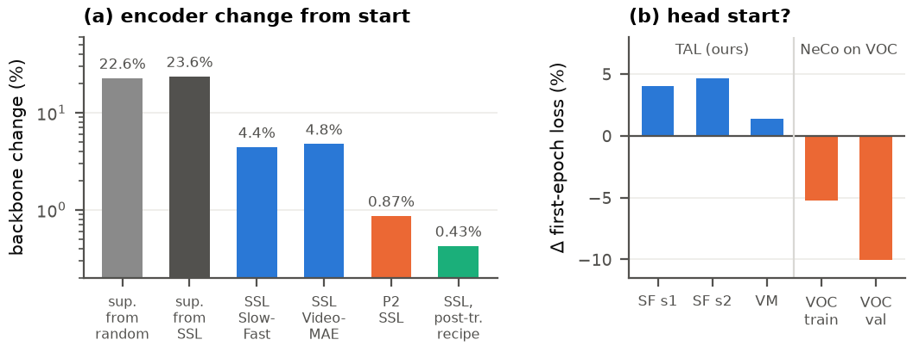

**How to read (a).** Relative weight change of the backbone from the point each stage
started at, on a log scale. Grey: supervised training from a random init (P1, 22.6%) and
from the SSL weights (P3 stage B, 23.6%, mean of three seeds). Blue: the SSL stage
(P3 stage A). Orange: P2 post-training, measured from the supervised weights. Green:
a from-scratch SSL stage run with NeCo's post-training learning rates.

**How to read (b).** First-epoch supervised loss of the SSL-initialised run minus that
of the randomly initialised run, in %, for seed-matched pairs (same head init and data
order). Bars above 0 = SSL start is worse. The orange bars are the same probe in NeCo's
own setting (VOC), for comparison.

**Takeaway.** The SSL stage does change the encoder (4.4–4.8%, a fifth of supervised
training), so the null result is not an untrained encoder. But that change is a slightly
*worse* starting point for TAL (+1.4 to +4.7% first-epoch loss), whereas on VOC NeCo's
change is a better one (−5 to −10%). Supervised training then moves the encoder 23–24%
from the SSL weights — as far as from a random init and ~5× further than SSL did.

### 0.6 Neighbour structure and scene identity (Fig. 5) — the central result


**How to read (a, b).** Verb-label lift (§0.1) of the encoder's per-timestep features,
for neighbours from other videos (left group) and from the same video (right group).
Each bar is one encoder: light grey = the raw input clip features, dark grey = the
ActionFormer encoder at its random init, orange = after NeCo SSL (pale orange: spatial
crops), dark orange = the supervised encoder after NeCo post-training (P2), blue =
supervised (P1), green = SSL-initialised then supervised (P3). Higher = same-verb
moments are closer together in feature space.

**How to read (c).** Fraction of a timestep's cross-video neighbours that come from the
same kitchen; dashed line = chance (0.03).

**Takeaway.**
- NeCo SSL from scratch **lowers** verb-label lift below even the untrained encoder
  (SlowFast 0.31 → 0.26 across videos, 0.39 → 0.34 within; VideoMAE-L 0.41 → 0.38 /
  0.48 → 0.46). On VOC the same kind of probe goes *up* with NeCo. In this setting the
  objective pulls same-verb moments apart.
- Supervised training raises the lift (blue), and the SSL-initialised encoder ends
  exactly where the randomly initialised one does (green ≈ blue): no measurable trace
  of the SSL stage remains.
- NeCo post-training (dark orange) leaves the verb grouping of the supervised encoder
  intact (0.375 vs. 0.375). So P2's −1.34 pp is not lost verb structure but the features
  shifting away from what the frozen heads were fitted to.
- Spatial crops (pale orange) give the same drop as temporal crops, so the cause is not
  how the views are made.
- (c) NeCo does **not** learn a scene shortcut: it *reduces* same-kitchen neighbours
  (SlowFast 0.50 → 0.31, below even supervised 0.34). It removes scene and verb
  structure together.

### 0.7 How similar are the two SSL views? (Fig. 6)

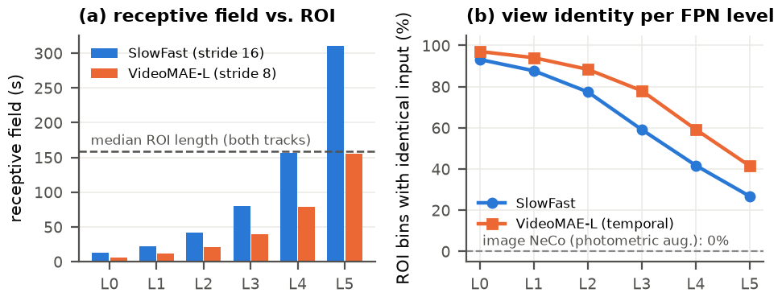

**How to read (a).** Receptive field (the span of input the encoder sees for one output
position) of each pyramid level, in seconds, against the median length of the overlap
region of the two SSL crops (dashed). (b) Fraction of overlap positions at each level
for which both crops give the encoder identical input, computed by running the actual
crop sampler on the real training-video lengths.

**Takeaway.** With temporal crops of pre-extracted features, 93% (SlowFast) / 97%
(VideoMAE-L) of the finest-level positions receive identical input in both views; only
the coarsest levels, whose receptive fields exceed the overlap, see different context.
Image NeCo's views differ at every pixel (colour, blur, scale). This made view identity
a natural suspect, but Fig. 5 shows spatial crops (which differ everywhere) behave the
same, so it is not the main cause.

### 0.8 Control: NeCo in its own setting (Fig. 7, Table 3)

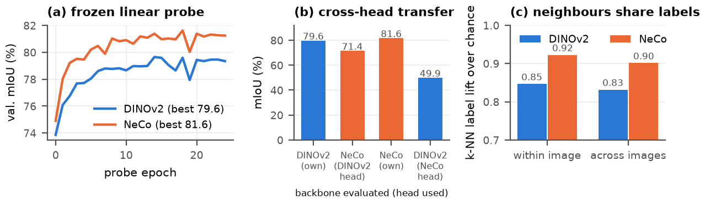

**How to read.** NeCo-post-trained DINOv2 (orange) vs. the original DINOv2 (blue) on
PASCAL VOC segmentation, identical seed-matched protocol. (a) mIoU of a frozen-backbone
linear probe per training epoch. (b) Cross-head transfer: a head trained on one backbone
evaluated on the other (x-axis = backbone evaluated, in brackets = whose head); a large
drop means the two representations genuinely differ rather than being rescaled
copies. (c) Patch-neighbour label lift — the same metric as Fig. 5, on image patches.

| Probe (NeCo vs. its start) | VOC (DINOv2) | EPIC: SlowFast / VideoMAE-L |
|---|---|---|
| neighbour-label lift, across images/videos | 0.83 → 0.90 | 0.31 → 0.26 / 0.41 → 0.38 |
| neighbour-label lift, within image/video | 0.85 → 0.92 | 0.39 → 0.34 / 0.48 → 0.46 |
| first-epoch downstream loss | −5% (train), −10% (val) | +4.0%, +4.7% / +1.4% |
| downstream metric | +2.0 mIoU | +0.44 pp (n.s.) / +0.04 pp |

**Takeaway.** In NeCo's own setting every probe points the right way: neighbours become
more label-consistent, the downstream task starts with a lower loss, and mIoU rises
by 2.0. On EPIC every probe points the other way. The objective is the same; what
differs is the setting. Views and scene shortcuts are ruled out above, which leaves the
starting representation: on VOC NeCo sharpens generic features whose neighbourhoods
already follow object classes; on EPIC it re-mixes clip features already supervised for
the target verbs, and its target (a consistent ordering relative to other videos) does
not coincide with verb identity.

### 0.9 Summary

NeCo-style SSL does not help ActionFormer on EPIC-KITCHENS-100 verbs. Post-training
costs 1.34 pp (head mismatch); pre-training is within seed noise on SlowFast (3 seeds)
and VideoMAE-L. The SSL stage works as an SSL stage (fits its objective, moves the
encoder 4–5%), but in this setting it moves timestep neighbourhoods away from verbs,
gives a slightly worse starting point, and supervised training erases it. Single-run
caveats: VideoMAE-L P3 and P2 are one seed each.

---

*Pre-fix part — §1–§8 below were last updated 2026-11-15 and describe the superseded
pipeline (see the header).*

*(Pre-fix) last updated: 2026-11-15 (NeCo diagnostics in its own DINOv2 → VOC setting, §7). Paths below are relative to `actionformer/` unless prefixed with `neco_diag/`.*

## 1. Overview

This report documents a set of experiments on the **EPIC-KITCHENS-100 verb** task
(temporal action localization, TAL) using **ActionFormer** (Zhang et al., ECCV 2022).
The research question is whether a *NeCo-style self-supervised (SSL)* stage can
improve downstream TAL performance, measured as mAP at different temporal-IoU (tIoU)
thresholds on the validation split. Two protocols are compared:

- SSL **post-training** on top of a converged supervised model (pipeline 2, §2.3), and
- SSL **pretraining** on an untrained encoder followed by standard supervised training
  (pipeline 3, §2.5) -- the ordering used in the original NeCo/DINO-style literature.

A follow-up ablation (§2.6) fine-tunes the post-trained model with its heads unfrozen
to test *why* post-training hurts.

**Summary of findings.**

| Protocol | SlowFast | VideoMAE-L | V-JEPA2 |
|---|---|---|---|
| Supervised baseline | 23.38 ± 0.75 (n=3) | 29.60 | 17.49 |
| SSL post-training, frozen heads (pipeline 2) | 22.55 | 29.24 | -- |
| ... + joint encoder/head fine-tune (ablation) | 22.45 (control: 22.97) | -- | -- |
| SSL pretraining → supervised (pipeline 3) | 23.65 ± 0.08 (n=3) | 29.38 | 17.40 |
| ... + frame-rate augmentation in SSL | **24.45** (n=1) | -- | -- |

(Avg mAP, EPIC-100 verb validation; mean ± sample sd over seeds where n > 1.)

1. **SSL post-training hurts**, on both feature tracks tested (SlowFast −0.52,
   VideoMAE-L −0.36), and re-training the heads jointly does not recover it: the
   damage is in the encoder.
2. **SSL pretraining does not raise mean mAP.** The single-seed +0.49 pp on SlowFast
   reported earlier shrinks to +0.27 pp over three seeds each, well inside seed
   noise (baseline sd 0.75), and there is no gain on V-JEPA2 or VideoMAE-L.
   It does make SlowFast training markedly **more stable across seeds**
   (sd 0.08 vs 0.75).
3. **Frame-rate augmentation in the SSL stage** gives the best SlowFast result so far
   (24.45, +0.80 over pipeline 3 without it), but on a single seed.
4. **Features dominate**: EPIC-finetuned VideoMAE-L features are +6.2 pp over
   SlowFast -- an order of magnitude more than any SSL effect.
5. **The null result is setting-specific.** In NeCo's own setting (DINOv2 →
   VOC semantic segmentation, §7) the same objective gives **+2.0 mIoU** on a
   frozen-backbone linear probe, a lower epoch-0 loss, and a higher
   patch-neighbour/label agreement. What fails on ActionFormer is applying NeCo
   to an encoder over frozen, already-supervised features for a sparse task --
   not the objective itself.

Experiments were run on the ALICE cluster (Leiden University). The project mirrors the
official ActionFormer codebase with an added self-supervised training stage.

## 2. Method and Experimental Setup

### 2.1 Task, data and features

- **Dataset**: EPIC-KITCHENS-100, verb-only track, trained on `training` split
  (495 videos), evaluated on `validation` split (138 videos).
- **Features**:
  - **SlowFast**: 2304-dim features extracted with a SlowFast network pre-trained on
    EPIC-KITCHENS (official features, 30 fps, 32-frame window, feature stride 16;
    density ~1.875 vectors/sec).
  - **V-JEPA2**: 1024-dim features extracted with a frozen V-JEPA2 (ViT-L fpc32)
    backbone, density matched to SlowFast (~1.875 vectors/sec).
  - **VideoMAE-L**: 1024-dim features from a VideoMAE-L-16x4x1 backbone
    **finetuned on EPIC-KITCHENS verbs**, as released by OpenTAD (16-frame clips,
    stride 8 at 30 fps, i.e. ~3.75 vectors/sec, 2x SlowFast). Config
    `epic_videomae_verb.yaml`: identical recipe to SlowFast except `input_dim`,
    `feat_stride: 8`, `num_frames: 16` and `max_seq_len: 4608` (same temporal span).
- **Evaluation metric**: mAP at tIoU in {0.1, 0.2, 0.3, 0.4, 0.5} and the average,
  following the ActionFormer paper.

All three pipelines share the same encoder (`ConvTransformerBackbone` + identity FPN
neck, 207 parameter tensors), so encoder weights transfer between them; only the task
heads differ (SSL projection head vs. supervised cls/reg/center heads, 22 tensors).

### 2.2 Supervised baseline (pipeline 1)

Standard ActionFormer training with focal classification loss + DIoU regression loss,
center sampling, and soft-NMS inference; 16 epochs + 5 warm-up, AdamW, lr 1e-4,
batch size 2. Configs `epic_slowfast_verb.yaml` / `epic_vjepa2_verb.yaml`, final
checkpoint `epoch_021.pth.tar`.

### 2.3 Self-supervised post-training (NeCo-style, pipeline 2)

The encoder is warm-started from the supervised `epoch_021` checkpoint and then
post-trained self-supervised for 12 effective epochs (10 + 2 warm-up, batch size 4)
using a NeCo-style objective: a teacher/student EMA framework with temporal ROI
alignment over two overlapping temporal crops of each video and a SoftSort-based
neighbour-ranking loss, on the same video features (no labels).

Conjecture tested: SSL post-training of the encoder improves the representation for
downstream TAL, and thus raises mAP.

### 2.4 Downstream evaluation of the post-trained model

The SSL-trained encoder (EMA weights) is merged with the **frozen supervised**
cls/reg/center heads from `epoch_021.pth.tar` and evaluated with the standard
ActionFormer inference pipeline (`eval_ssl.py --head-from ...`; 207 encoder keys from
the SSL checkpoint, 22 head keys from the supervised checkpoint).

### 2.5 SSL pretraining then supervised training (pipeline 3)

1. **Stage A -- SSL pretraining on an untrained encoder.** `train_ssl.py` from a
   **random encoder init**, 12 effective epochs, same NeCo objective as §2.3.
2. **Stage B -- full supervised training from the SSL-pretrained encoder.**
   `train.py --init-encoder` loads only the backbone+neck weights from the SSL
   checkpoint's **EMA (teacher)** state, leaves the heads at random init, then trains
   the **entire model** with the unmodified supervised recipe (§2.2). The only
   difference from the baseline is the encoder's starting point.

Run for SlowFast (3 seeds, §2.8), V-JEPA2 and VideoMAE-L.

### 2.6 Joint fine-tune ablation on pipeline 2

Tests the head-mismatch explanation for pipeline 2's drop (§5.1) directly. Starting
from the *exact* pipeline-2 model (SSL post-trained EMA encoder + supervised
`epoch_021` EMA heads; `train.py --init-model <supervised> --init-encoder <ssl>`),
encoder **and** heads are fine-tuned jointly with the supervised loss, using a short
schedule suited to an already-converged model
(`configs/epic_slowfast_verb_joint_ft.yaml`: 1 warm-up + 5 cosine epochs, lr 2e-5 =
1/5 of the base lr).

A **control** runs the identical schedule from the unmodified supervised baseline
(no SSL), so the effect of extra supervised epochs is separated from the effect of
the SSL encoder.

### 2.7 Feature-level frame-rate augmentation

A variant of the SSL view sampling (§2.3) that also changes the *playback rate* of
each view. After the two temporal crops are sampled, each training view gets an
independent rate r ~ log-uniform[0.5, 2]. The crop [s, e) is resampled by linear
interpolation at raw feature positions s, s + r, s + 2r, ...: r > 1 plays it faster
(fewer vectors), r < 1 slower (more, interpolated vectors). The shared ROI is mapped
into each view with the view's stride × r, so both views are still aligned on the
same raw moments and the NeCo target is unchanged; the model must now match
neighbourhoods across different apparent action durations. Validation views always
use r = 1, so validation losses stay comparable with the other runs.

This operates on the pre-extracted feature sequence -- no re-extraction. Each SlowFast
vector still encodes ~1 s of normal-speed motion, so this is sequence-rate
(action-duration) augmentation rather than true motion-speed augmentation.
Implementation: `ssl.rate_range` in the SSL config (`[1, 1]`, the default, is
bit-identical to the original code); geometry test in
`tools/test_rate_augmentation.py`. Run through pipeline 3 on SlowFast
(`configs/ssl_epic_slowfast_verb_rate.yaml`).

### 2.8 Seed replicates

The SlowFast baseline and SlowFast pipeline 3 were repeated with two additional seeds
(`--seed 1`, `--seed 2`, overriding the config's `init_rand_seed`; the original runs
use the default seed). For pipeline 3 **both** stages are re-seeded, so the spread
includes SSL-stage variance as well as supervised-stage variance.

## 3. Results

> ⚠ **Pre-fix (before 2026-11-22):** pre-fix SSL numbers; see the header for corrected results.

### 3.1 Main results (EPIC-100 verb, validation)

| Model | tIoU 0.1 | tIoU 0.2 | tIoU 0.3 | tIoU 0.4 | tIoU 0.5 | Avg mAP |
|---|---|---|---|---|---|---|
| Supervised baseline (SlowFast) | 26.40 | 25.15 | 23.73 | 21.70 | 18.35 | **23.07** |
| + SSL post-training, frozen heads (pipeline 2) | 26.14 | 24.70 | 23.20 | 20.93 | 17.79 | **22.55** |
| + SSL post-training + joint fine-tune (§2.6), final epoch | 26.15 | 24.78 | 23.14 | 21.21 | 17.83 | **22.45** |
| Control: baseline + same joint fine-tune, no SSL, final epoch | 26.41 | 25.16 | 23.55 | 21.52 | 18.22 | **22.97** |
| SSL pretrain → supervised (SlowFast, pipeline 3) | 26.72 | 25.63 | 24.10 | 22.37 | 18.99 | **23.56** |
| Supervised baseline (V-JEPA2) | 20.51 | 19.74 | 18.38 | 16.17 | 12.64 | **17.49** |
| SSL pretrain → supervised (V-JEPA2, pipeline 3) | 20.33 | 19.49 | 18.11 | 15.87 | 13.19 | **17.40** |
| SSL pretrain → supervised, rate-augmented SSL (SlowFast, §2.7) | 27.92 | 26.68 | 25.15 | 22.79 | 19.70 | **24.45** |
| Supervised baseline (VideoMAE-L, EPIC-finetuned) | 32.84 | 32.06 | 30.42 | 28.11 | 24.59 | **29.60** |
| + SSL post-training, frozen heads (VideoMAE-L, pipeline 2) | 32.65 | 31.80 | 29.96 | 27.83 | 23.97 | **29.24** |
| SSL pretrain → supervised (VideoMAE-L, pipeline 3) | 32.83 | 32.23 | 30.58 | 27.84 | 23.46 | **29.38** |

SlowFast rows without a seed are the default-seed runs; see §3.5 for the seed
replicates.

### 3.2 Joint fine-tune ablation, per epoch

Average mAP of the EMA model after each fine-tune epoch:

| Epoch | 1 | 2 | 3 | 4 | 5 | 6 |
|---|---|---|---|---|---|---|
| SSL post-trained + joint fine-tune | 22.48 | 22.47 | 22.52 | 22.61 | 22.60 | 22.45 |
| Control (no SSL) | 23.02 | 22.98 | 23.02 | 23.01 | 22.94 | 22.97 |

The gap to the control (~0.5 pp) is flat across all six epochs: there is no upward
trend that a longer fine-tune at this learning rate would plausibly extend.

### 3.2.1 V-JEPA2 pipeline 3 vs. baseline, per epoch

| Epoch | 1 | 5 | 10 | 15 | 20 | 21 |
|---|---|---|---|---|---|---|
| V-JEPA2 baseline (random init) | 0.07 | 5.56 | 12.53 | 16.03 | 17.40 | 17.49 |
| V-JEPA2, SSL-pretrained encoder | 0.06 | 5.54 | 12.84 | 16.24 | 17.35 | 17.40 |

The SSL-initialized run is marginally ahead mid-training (+0.2–0.3 pp at epochs
10/15) but converges to the same value; the two curves are indistinguishable at
the end.

### 3.3 SSL training signals

| Run | Encoder init | Final val NeCo loss | Final top-1 agreement |
|---|---|---|---|
| SlowFast, post-training (pipeline 2) | supervised epoch_021 | 5.59 | 0.832 |
| SlowFast, pretraining (pipeline 3, stage A) | random | 2.20 | 0.769 |
| V-JEPA2, post-training | supervised epoch_021 | 5.95 | 0.835 |
| V-JEPA2, pretraining (pipeline 3, stage A) | random | 1.77 | 0.839 |
| SlowFast, pretraining, seed 1 | random | 2.16 | 0.786 |
| SlowFast, pretraining, seed 2 | random | 2.21 | 0.780 |
| SlowFast, pretraining + rate augmentation | random | 2.29 | 0.769 |
| VideoMAE-L, post-training (pipeline 2) | supervised epoch_021 | 5.16 | 0.849 |
| VideoMAE-L, pretraining (pipeline 3, stage A) | random | 2.41 | 0.849 |

NeCo losses are not comparable *across* encoder inits: a supervised encoder starts
with a very different feature geometry (the warm SlowFast run starts at ~17 and ends
at 5.6), so a lower loss for the random-init runs does not mean a better
representation. Within an init they are consistent: the three random-init SlowFast
seeds end at 2.16–2.21, and the rate-augmented run (validated at rate 1) at 2.29 --
the harder training views barely change how well the objective fits.

### 3.4 Training-loss curves

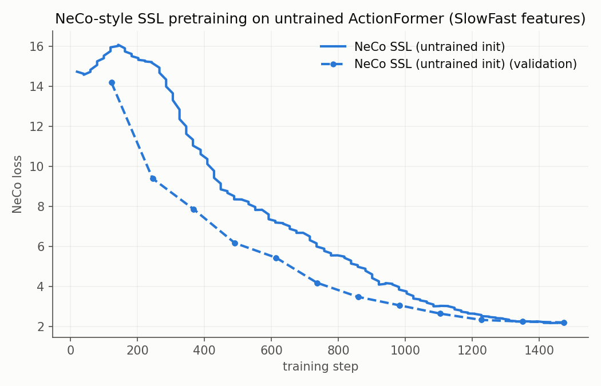

*Pipeline 3 stage A (SlowFast): train and validation NeCo loss from random init.*

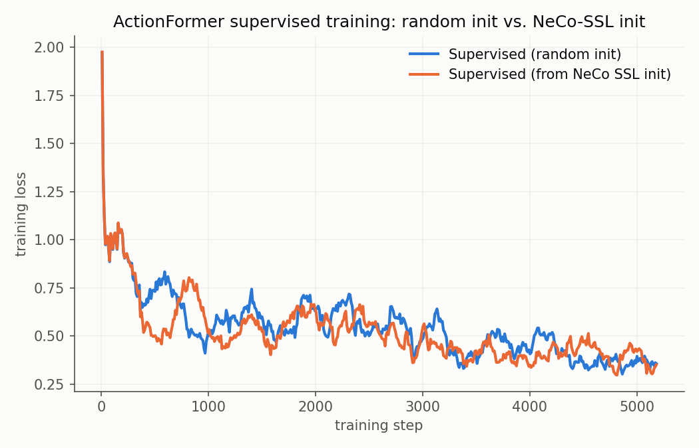

*Supervised training loss, baseline (random encoder) vs. pipeline 3 stage B
(SSL-initialized encoder).*

The two supervised loss curves are effectively indistinguishable: same starting value,
same noisy trajectory, same final training loss (~0.35). SSL pretraining does **not**
show up as a lower starting loss or faster convergence; whatever it changes shows up
only in validation mAP and its seed-to-seed spread (§5.2).

**Does the SSL init start lower?** The first epoch is the cleanest test of whether
the NeCo objective is aligned with the downstream TAL objective. In stage B the
cls/reg/center heads are randomly initialised in *both* runs and, for a seed-matched
pair, the head init and the data order are identical -- so any difference in the
supervised loss over epoch 1 is attributable to the encoder. It is absent:

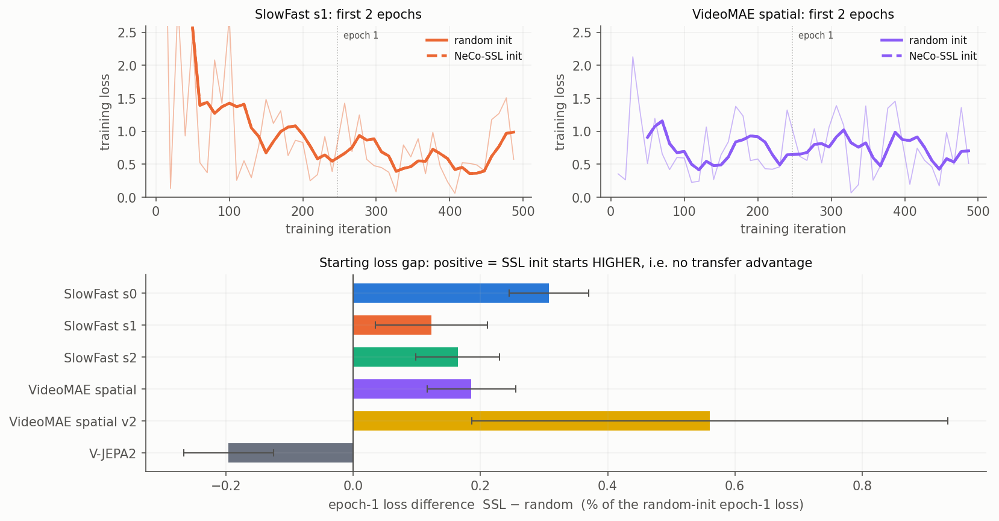

*Top: supervised loss over the first two epochs, random vs. SSL init (seed-matched
pairs; thin = per-minibatch, thick = 5-point moving average). Bottom: mean epoch-1
loss difference (SSL − random) as a percentage of the random-init loss, with the
paired standard error over minibatches. Positive = the SSL-initialised model
starts **higher**.*

| Track | first minibatch (random / SSL) | epoch-1 mean (random / SSL) | Δ epoch 1 (SSL − random) |
|---|---|---|---|
| SlowFast, seed 0 | 1.9725 / 1.9762 | 0.9348 / 0.9377 | +0.003 (+0.31%) |
| SlowFast, seed 1 | 6.4119 / 6.4043 | 1.2500 / 1.2516 | +0.002 (+0.12%) |
| SlowFast, seed 2 | 2.8227 / 2.8234 | 1.2886 / 1.2908 | +0.002 (+0.16%) |
| VideoMAE-L spatial | 0.3534 / 0.3548 | 0.7362 / 0.7376 | +0.001 (+0.19%) |
| VideoMAE-L spatial v2 | 0.3534 / 0.3549 | 0.7362 / 0.7403 | +0.004 (+0.56%) |
| V-JEPA2 | 0.3240 / 0.3236 | 0.8216 / 0.8200 | −0.002 (−0.20%) |

Five of six SSL-initialised runs start *slightly higher*, not lower; the largest
gap is 0.56% (VideoMAE v2, the variant that moved its encoder 12× more than v1 and
ended with the worst mAP, 28.65). The one run that starts lower, V-JEPA2, has a
*worse* downstream mAP than its baseline (17.40 vs. 17.49) and sits ~0.5–1% below
the random-init curve in 19 of 21 epochs (the other two are +0.1% and +0.6%) while
generalising worse. A lower supervised
loss at the start is therefore not evidence that the SSL objective transfers: it
can equally reflect overfitting to the training videos. Either way, the loss curve
provides **no sign of a representation head-start** for NeCo, which is the
loss-curve counterpart of the CKA result in §6.3 (the SSL stage-A encoder is about
as far from the supervised encoder as a random init is).

Caveats: batch size 2 makes individual minibatch losses extremely noisy (0.06–6.4
within one epoch), so single points are not comparable -- the first logged loss of
the same recipe is 1.97, 6.41 and 2.82 on three seeds. Only the epoch mean, averaged
over its 24 minibatches, is stable. Even that is a weak probe: with freshly
initialised heads, most of the loss is set by the head, so it has limited
sensitivity to encoder quality. The seed-0 runs predate `--seed` and do not share a
data order; seeds 1–2 are exactly paired.

### 3.5 Seed replicates (SlowFast)

| Run | tIoU 0.1 | tIoU 0.2 | tIoU 0.3 | tIoU 0.4 | tIoU 0.5 | Avg mAP |
|---|---|---|---|---|---|---|
| Baseline, default seed | 26.40 | 25.15 | 23.73 | 21.70 | 18.35 | 23.07 |
| Baseline, seed 1 | 26.15 | 25.01 | 23.66 | 21.32 | 18.06 | 22.84 |
| Baseline, seed 2 | 27.45 | 26.36 | 25.09 | 22.91 | 19.32 | 24.23 |
| **Baseline, mean ± sd** | | | | | | **23.38 ± 0.75** |
| Pipeline 3, default seed | 26.72 | 25.63 | 24.10 | 22.37 | 18.99 | 23.56 |
| Pipeline 3, seed 1 | 26.85 | 25.81 | 24.51 | 22.09 | 19.11 | 23.67 |
| Pipeline 3, seed 2 | 26.86 | 25.99 | 24.73 | 22.56 | 18.48 | 23.72 |
| **Pipeline 3, mean ± sd** | | | | | | **23.65 ± 0.08** |

Difference of means: **+0.27 pp** (Welch t ≈ 0.6, n = 3 each; not significant).
Seed-to-seed spread of the baseline (range 1.39 pp) is ~3× the originally reported
single-seed gain, while the three pipeline-3 runs lie within 0.16 pp of each other.

## 4. Comparison with ActionFormer (paper, Table 2)

ActionFormer, Table 2 (EPIC-Kitchens 100 validation set, verb task, SlowFast
features):

| Method | tIoU 0.1 | tIoU 0.2 | tIoU 0.3 | tIoU 0.4 | tIoU 0.5 | Avg mAP |
|---|---|---|---|---|---|---|
| BMN | 10.8 | 9.8 | 8.4 | 7.1 | 5.6 | 8.4 |
| G-TAD | 12.1 | 11.0 | 9.4 | 8.1 | 6.5 | 9.4 |
| ActionFormer (paper) | 26.6 | 25.4 | 24.2 | 22.3 | 19.1 | **23.5** |

### 4.1 Ours vs. paper

| Method (this work) | tIoU 0.1 | tIoU 0.2 | tIoU 0.3 | tIoU 0.4 | tIoU 0.5 | Avg mAP | Δ vs. paper |
|---|---|---|---|---|---|---|---|
| Supervised baseline (repro) | 26.40 | 25.15 | 23.73 | 21.70 | 18.35 | 23.07 | −0.43 |
| Baseline + SSL post-training | 26.14 | 24.70 | 23.20 | 20.93 | 17.79 | 22.55 | −0.95 |
| SSL pretrain → supervised (pipeline 3) | 26.72 | 25.63 | 24.10 | 22.37 | 18.99 | 23.56 | **+0.06** |
| ActionFormer paper | 26.6 | 25.4 | 24.2 | 22.3 | 19.1 | 23.5 | -- |

Notes on comparability:

- The reproduced baseline (23.07) is 0.43 pp below the paper (23.5), with closely
  matching per-threshold trends. With seed replicates the baseline is
  23.38 ± 0.75 (range 22.84–24.23), which **contains the paper's 23.5**: the
  "reproduction gap" is within seed noise, and "pipeline 3 beats the paper" (+0.06)
  is not a meaningful claim.
- The OpenTAD reimplementation reports **24.93** avg mAP for ActionFormer on
  EPIC-100 verb with their own EPIC-finetuned SlowFast features, above both the
  paper and our reproduction. Absolute numbers are therefore sensitive to the exact
  feature release; comparisons within this report all use the same features and
  recipe.
- The V-JEPA2 track has no counterpart in the paper.
- The VideoMAE-L baseline (29.60) is not comparable to the paper's SlowFast number:
  its backbone was finetuned on EPIC verbs by OpenTAD. It is included as a stronger
  feature track, not as a reproduction.

## 5. Analysis

> ⚠ **Pre-fix (before 2026-11-22):** pre-fix; conclusions partly invalid, see header.

### 5.1 SSL post-training does not improve TAL performance

NeCo-style post-training on top of the supervised model **decreases** average mAP
from 23.07 to 22.55 (−0.52 pp, −2.3% relative), at every tIoU threshold, with the
largest drops at 0.4/0.5 where boundary quality matters. The SSL objective itself
converges (agreement 0.565 → 0.832, loss ~17 → 5.6), so this is a transfer problem,
not an optimization failure.

Candidate explanations considered originally:

1. **The supervised model is already converged**, and the SSL objective pulls the
   encoder toward a different solution that is worse for localization.
2. **Head mismatch**: the heads are frozen while the encoder drifts, so the decoder
   cannot compensate.
3. **Short post-training budget** (12 effective epochs).
4. **SSL convergence ≠ downstream quality**, especially for boundary regression.

Explanation 2 was initially considered the load-bearing one. §5.3 tests it and
**rules it out** as the main cause.

### 5.2 SSL pretraining followed by supervised training: more stable, not better on average

With a single seed, pipeline 3 appeared to give **+0.49 pp** on SlowFast (23.56 vs
23.07), ahead at every tIoU threshold. The seed replicates (§3.5) change this:

- **Mean effect is within noise.** 23.65 ± 0.08 vs 23.38 ± 0.75, a +0.27 pp
  difference with t ≈ 0.6. The original baseline run happened to be on the low side
  of its own distribution.
- **Variance drops sharply.** The three SSL-initialized runs span 0.16 pp; the three
  baselines span 1.39 pp. Every SSL-initialized run is above the baseline *median*
  (23.07), but one baseline seed (24.23) beats all of them. With n = 3 per arm, the
  variance difference is suggestive rather than established, but it is the most
  consistent signal in the pipeline-3 data.
- **No gain on the other tracks.** V-JEPA2: 17.40 vs 17.49. VideoMAE-L: 29.38 vs
  29.60 (single seeds; both within the noise level measured on SlowFast).

The supervised *training* loss (§3.4) is indistinguishable between SSL-initialized
and random-init runs, consistent with SSL init affecting which solution training
settles in (a representation prior / stabilizer) rather than how fast the loss is
fit.

### 5.3 Joint fine-tune ablation: head mismatch is not the explanation

If pipeline 2 lost accuracy only because the frozen heads no longer fit the drifted
encoder, then fine-tuning heads and encoder together should recover the baseline.
It does not (§3.1, §3.2):

- The SSL post-trained model stays at **22.45–22.61** throughout the fine-tune,
  i.e. at the frozen-head level (22.55).
- The control, given the same extra supervised epochs, stays at **22.94–23.02**,
  i.e. at the baseline level. Extra fine-tuning by itself neither helps nor hurts.
- The ~0.5 pp gap persists at every epoch and every tIoU threshold.

So the damage from SSL post-training lives in the **encoder itself**: within this
fine-tune budget, supervised gradients do not move it back to an equally good
solution. This leaves explanations 1 and 4 of §5.1.

It also changes how pipeline 3 should be read: the difference between the protocols
is not "the heads were allowed to adapt" -- the ablation shows that alone is not
enough. It is that SSL is used as an **initialization**, followed by a *full*
supervised schedule (warm-up at the base learning rate) that can reshape the whole
encoder around the task. That is enough to avoid the post-training damage, but, per
§5.2, not enough to produce a reliable mean gain.

**Caveat.** The fine-tune was deliberately short and low-learning-rate (6 epochs at
lr 2e-5). A full-length, base-learning-rate schedule starting from the post-trained
encoder is untested; it would effectively become pipeline 3 with a different
initialization.

### 5.4 Feature track

- SlowFast features (2304-dim, EPIC pre-trained) are the stronger feature set;
  frozen V-JEPA2 features lag by ~5.6 pp (17.49 vs 23.07). V-JEPA2 is not
  EPIC-adapted, consistent with TAL features benefiting from in-domain fine-tuning.
- Feature densities are matched (~1.875 vectors/sec), so the gap is not a sampling
  artifact.
- **EPIC-finetuned VideoMAE-L features are far stronger**: 29.60 avg mAP, +6.53 pp
  over SlowFast and +12.1 pp over frozen V-JEPA2, ahead at every tIoU threshold
  with the unmodified SlowFast recipe (only feature-shape parameters changed).
  Feature quality dominates everything else in this report: the gap between
  feature sets is an order of magnitude larger than any SSL effect.
- **V-JEPA2 through pipeline 3: no gain.** 17.40 vs 17.49 (−0.09 pp). The only
  threshold where the SSL-initialized model is ahead is tIoU 0.5 (13.19 vs 12.64);
  the rest are 0.2–0.3 pp lower. The SSL stage itself converged normally (final val
  NeCo loss 1.77, agreement 0.839, §3.3).
- **VideoMAE-L through both SSL protocols** reproduces the SlowFast pattern on a much
  stronger baseline:
  - post-training (pipeline 2) **hurts**: 29.24 vs 29.60 (−0.36), lower at every
    tIoU threshold, as on SlowFast (−0.52);
  - pretraining (pipeline 3) gives **no gain**: 29.38 vs 29.60 (−0.22; ahead at
    tIoU 0.2/0.3, behind at 0.4/0.5).

### 5.5 Frame-rate augmentation

Adding the per-view rate augmentation (§2.7) to pipeline 3 gives **24.45 avg mAP** on
SlowFast -- the best SlowFast result in this report, and ahead of pipeline 3 without
it at every tIoU threshold (27.92 / 26.68 / 25.15 / 22.79 / 19.70 vs the 3-seed means
26.81 / 25.81 / 24.45 / 22.34 / 18.86).

- vs. pipeline 3 without rate augmentation: **+0.80** over its 3-seed mean. Given
  that pipeline 3's seeds span only 0.16 pp, this is well outside its observed spread.
- vs. the baseline: +1.07 over its mean, and above its best seed (24.23).
- The SSL objective itself is fit about as well as without the augmentation (val
  NeCo loss 2.29 vs 2.16–2.21, measured at rate 1), so the difference comes from
  *what* is learned, not how well the objective converges.

This is a **single seed**, and it is the first result in this study where an SSL
variant plausibly beats the baseline distribution rather than a single baseline
run. It is the obvious candidate for seed replication, and for testing on VideoMAE-L.


### 5.6 Conclusions

- **SSL post-training on a converged model hurts** on both SlowFast (−0.52) and
  VideoMAE-L (−0.36), and **jointly re-training the heads does not rescue it**
  (22.45 vs a 22.97 control). The post-trained encoder is itself worse for
  localization. This is the most robust finding of the study: it holds across
  feature tracks and has a clean control.
- **SSL pretraining with the original temporal-crop views does not improve mean
  mAP** on any feature track (SlowFast +0.27 over 3 seeds, within noise; V-JEPA2
  −0.09; VideoMAE-L −0.22). The earlier single-seed "+0.49 pp, beats the paper"
  result was seed noise in the baseline. On SlowFast it does make training much more
  stable across seeds (sd 0.08 vs 0.75).
- **Frame-rate augmentation changes the picture**, at least on one seed: 24.45 on
  SlowFast, +0.8 above pipeline 3 without it. Whether SSL pretraining helps may
  depend on *which invariance* the views teach -- matching crops of the same speed
  gives no mean gain; matching across playback rates might.
- **Feature quality dominates**: VideoMAE-L features give +6.2 pp over SlowFast,
  an order of magnitude more than any SSL effect.
- **NeCo itself is not the problem.** In its own setting (DINOv2 → VOC
  segmentation) the objective improves dense prediction by +2.0 pp and lowers
  the epoch-0 loss by 5–10% (§7). The null result is about applying it to a frozen,
  already-supervised feature encoder for a sparse task.

**Limitations.** Seed replicates exist only for the SlowFast baseline and pipeline 3
(n = 3 each); every other row, including the rate-augmented result, is a single
seed. The SlowFast baseline's seed spread (sd 0.75) means single-seed differences
below ~1.5 pp should not be interpreted.

## 6. Encoder-level analysis: why SSL on the ActionFormer encoder does not help

> ⚠ **Pre-fix (before 2026-11-22):** pre-fix encoders; superseded by `paper/main.pdf` §6.

This section documents *why* the NeCo SSL stage does not improve downstream TAL,
using weight-space and representation-space measurements rather than mAP alone.
The short version:

> **The frozen extracted features are the only information source, and SSL never
> touches them. SSL only re-mixes them inside the ActionFormer encoder, and the
> NeCo objective can be satisfied almost entirely by the projection head. After
> supervised training both initialisations converge to essentially the same
> encoder, so the residual differences are at seed-noise level. When the encoder
> is *forced* to train more (v2), it moves slightly *away* from the supervised
> optimum and mAP gets worse, not better.**

### 6.1 What SSL can and cannot change

```
frozen extracted features (fixed .npy/.npz files)
            |                              (SSL never touches these)
            v
    ActionFormer encoder (backbone + neck)   <-- the only thing SSL trains
            v
    task heads (cls / reg / center)          <-- only in supervised training
```

The extracted features are **byte-for-byte identical** across all runs: the
backbone is frozen and there is no code path that rewrites the feature files.
SSL can therefore only reshape *how the encoder combines* a fixed
representation, never the representation itself. That bounds what any
encoder-side SSL objective can achieve.

### 6.2 The encoder barely moves during SSL

Relative L2 change from the random init, measured per parameter group
(`tools/plot_ssl_analysis.py`):

| stage | backbone | neck | projection head |
|---|---|---|---|
| supervised (16 ep, lr 1e-4) | **0.238** | 0.014 | — |
| SSL v1, SlowFast (12 ep, lr 2e-5) | 0.0047 | 0.0005 | 0.121 |
| SSL v1, VideoMAE spatial | 0.0046 | 0.0005 | 0.123 |
| SSL v1, VideoMAE temporal | 0.0046 | 0.0005 | 0.122 |
| SSL v2 (encoder lr 1e-4, head×1, clip 5, 20 ep) | **0.0556** | 0.0036 | 0.100 |

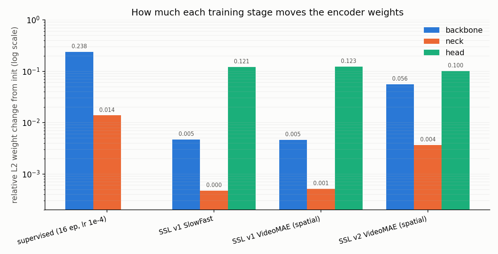

Supervised training moves the backbone ~**24%**; SSL v1 moves it **0.46%**
(50× less) while the projection head moves **12%**. So the "SSL-pretrained
encoder" used by pipeline 3 is essentially a **random init**, and pipeline 3 =
supervised from a random init = baseline. This alone explains the v1 null
results. v2 (the fix) raises encoder movement 12× to 5.6%, still 4× below
supervised.

### 6.3 The SSL stage-A representation is far from the supervised one

Linear CKA between the SSL stage-A encoder and the trained supervised encoder
(60/40 validation videos, `tools/visualize_encoder_similarity.py`):

| pair | mean CKA | per-position cosine |
|---|---|---|
| SSL stage-A vs supervised (VideoMAE) | 0.664 | 0.424 |
| SSL stage-A vs supervised (SlowFast) | 0.489 | 0.260 |
| random init vs supervised (VideoMAE) | 0.619 | 0.007 |
| random init vs supervised (SlowFast) | 0.486 | 0.002 |

The SSL encoder's representation is **about as far from the supervised
representation as an untrained random init** — i.e. NeCo does not move the
representation toward the supervised solution.

### 6.4 After supervised training, both encoders converge to nearly the same representation

| pair | mean CKA | per-position cosine |
|---|---|---|
| baseline vs SSL v1 → supervised (VideoMAE) | **0.970** | 0.873 |
| baseline vs SSL v1 → supervised (SlowFast) | 0.929 | 0.709 |
| baseline vs SSL v2 → supervised (VideoMAE) | 0.943 | 0.685 |
| baseline vs **baseline seed1** (noise floor) | 0.899 | −0.003 |
| SSL v1 → supervised vs baseline seed1 | 0.896 | −0.004 |

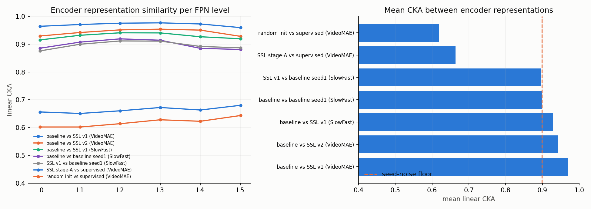

The last two rows are the decisive comparison: when the seed differs, the
SSL-initialised encoder is **exactly as different from a baseline as two random
seeds are from each other**. So the SSL init leaves no distinguishable trace on
the final encoder. The PCA panel below (baseline vs SSL v1 → supervised,
VideoMAE) shows near-total overlap:

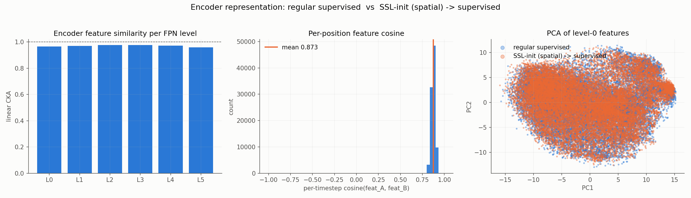

### 6.5 Weight-cosine is a shared-init artifact (a caution)

The backbone weight-cosine between baseline and SSL v1 → supervised is **0.976**,
which looks like "SSL barely changed the weights." But:

| comparison | weight cosine |
|---|---|
| supervised vs fresh init **with the training seed** | **0.974** |
| supervised vs fresh init with an arbitrary seed | 0.550 |
| SSL stage-A vs fresh init with the training seed | **1.0006** |

A *fresh* model initialised with the training seed already has weight-cosine
0.974 with the trained supervised model. So the metric mostly measures whether
two runs **shared the same random init** (both runs used the same
`init_rand_seed`), not whether SSL had an effect. Weight-cosine is therefore not
a usable indicator here; CKA and the relative-delta measures above are the
informative ones.

### 6.6 Forcing the encoder to train more (v2) makes it slightly worse

v2 changed exactly the suspects from §6.2: encoder lr 2e-5 → 1e-4,
`head_lr_scale` 10 → 1, `clip_grad_l2norm` 1 → 5, epochs 12 → 20.

| | v1 | v2 |
|---|---|---|
| backbone rel. change from init | 0.0046 | 0.056 |
| val NeCo loss | 2.80 | **2.19** |
| neighbour agreement | 0.843 | **0.889** |
| CKA to baseline after supervised | 0.970 | 0.943 |
| **downstream avg mAP** | **29.38** | **28.65** |

So increasing encoder training improves the SSL metrics but **degrades**
downstream TAL and pushes the final representation slightly further from
baseline. This weakens the "SSL simply wasn't training the encoder" explanation:
even when the encoder does move, NeCo moves it in an unhelpful direction.

### 6.7 Crop style is irrelevant

All VideoMAE-L variants, same objective/encoder/downstream recipe:

| variant | avg mAP |
|---|---|
| baseline | **29.60** |
| temporal-crop SSL | 29.38 |
| spatial-crop SSL | 29.38 |
| spatial+temporal SSL | 28.90 |
| spatial-crop SSL (v2) | 28.65 |

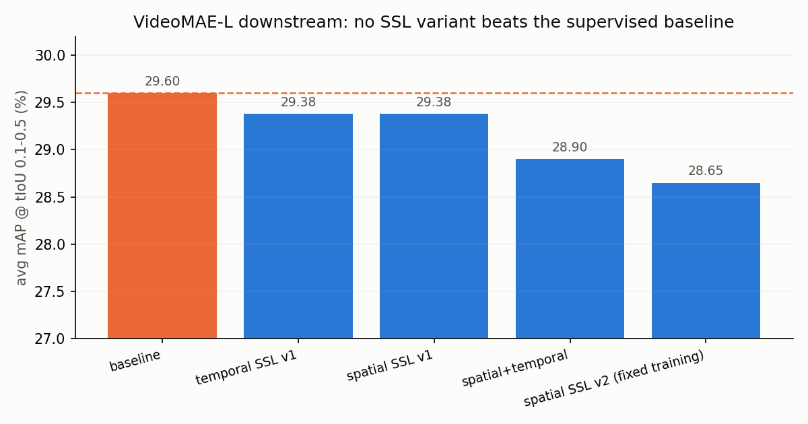

Temporal, spatial and combined crops all land below the baseline, which is what
you would expect if the binding constraint is the frozen representation rather
than the augmentation.

### 6.8 Explanation

1. **Information is fixed before SSL.** The features are already EPIC-finetuned;
   SSL and the baseline see exactly the same tensors.
2. **The objective is not task-aligned.** NeCo enforces neighbour-order
   consistency across augmentations, not action boundaries or verb classes. The
   start-of-training loss is the direct downstream test of this: an SSL-initialised
   encoder does not give a lower supervised loss in epoch 1 -- if anything it is
   0.1-0.6% higher (§3.4). Note the scope: in NeCo's *own* setting the same
   objective does lower the epoch-0 loss and improves dense prediction
   (§7), so "not aligned" here means "not aligned with *this* task", not a
   property of NeCo in general.
3. **The head absorbs it.** The self-generated EMA target is easy to satisfy
   with the expressive projection head, so the encoder barely moves (§6.2) and
   its representation stays far from supervised (§6.3).
4. **Supervised training dominates.** From either init, supervised training
   converges to CKA 0.94–0.97 vs baseline, versus a 0.90 seed-noise floor
   (§6.4). Residual differences are at seed-noise level.
5. **More SSL training is mildly harmful** (§6.6), because it moves the encoder
   away from the supervised optimum rather than toward a better one.

Together these explain the headline finding: **feature choice dominates (+6.2 pp
VideoMAE-L over SlowFast) while every SSL variant changes mAP by <1 pp and
downward.** The bottleneck is the frozen feature representation, not the crop
style, not the encoder init, and not (for v2) the amount of encoder SSL
training.

### 6.9 What would change the outcome

To act on the *information content* instead of re-mixing it (see
`feature_ideas.md`): fine-tune the backbone end-to-end (adapter/LoRA),
domain-adaptive MAE pretraining on EPIC videos, stronger features
(InternVideo2), or audio fusion.

Remaining caveats: v2 still moved the encoder only 5.6% vs supervised 23.8%, so a
*fully-trained-encoder* run (much higher encoder lr / weaker head / no clip) is
the last untested configuration; VideoMAE seed noise was not measured; CKA 0.90
is the generic floor between any two trained ActionFormers.

### 6.10 Methods

- `tools/visualize_encoder_similarity.py` — linear CKA per FPN level,
  per-position cosine, PCA scatter, weight cosine; loads two checkpoints
  (including `--use-ema` for the SSL teacher and `--random-a` for an untrained
  control) and encodes the same validation videos through `backbone → neck`.
- `tools/plot_ssl_analysis.py` — weight-movement, CKA and mAP figures + a JSON
  summary (`figs/ssl_analysis_summary.json`).
- Figures: `figs/ssl_analysis_encoder_movement.png`, `figs/ssl_analysis_cka.png`,
  `figs/ssl_analysis_map.png`, `figs/encoder_similarity_*/encoder_similarity.png`.
- Metrics: *relative L2 delta* = ||W − W_init||₂/||W_init||₂ per parameter group;
  *linear CKA* = ||XᵀY||²_F/(||XᵀX||_F·||YᵀY||_F) on centered per-position
  feature matrices (rotation-invariant).

**CKA in brief.** Centered Kernel Alignment compares two representations of the
*same* n examples by the geometry they induce (which examples are similar to
which). For column-centred feature matrices X (n×p) and Y (n×q),

```
CKA = ||XᵀY||²_F / ( ||XᵀX||_F · ||YᵀY||_F )  ∈ [0, 1]
```

It equals 1 when Y is X up to a rotation/reflection/isotropic scaling, and ≈0
when the two are unrelated; it works when p ≠ q. Two consequences matter here:
(a) because CKA is rotation-invariant, it can be high while per-position cosine
is ≈0 (same geometry, rotated feature basis) — so both are reported; (b) absolute
values are only meaningful against a control. In this work two independently
seeded baselines give CKA **0.90**, which is the "same recipe, different seed"
floor; baseline vs SSL → supervised is **0.94–0.97** (just above it), whereas the
SSL stage-A encoder vs supervised is **0.49–0.66** (far below). CKA therefore
answers "is the *information* the same?", while cosine answers "are the *vectors*
aligned in the same basis?".

## 7. NeCo in its own setting: DINOv2 → semantic segmentation

The ActionFormer experiments apply NeCo to an encoder sitting on top of *frozen,
already supervised* features — a setting the method was never designed for.
This section runs the same question in the paper's own setting: NeCo
post-training of a DINOv2 ViT-S/14 backbone, evaluated by PASCAL VOC 2012
semantic segmentation. If the NeCo objective were generically "too far from the
downstream objective", it should fail here too. It does not.

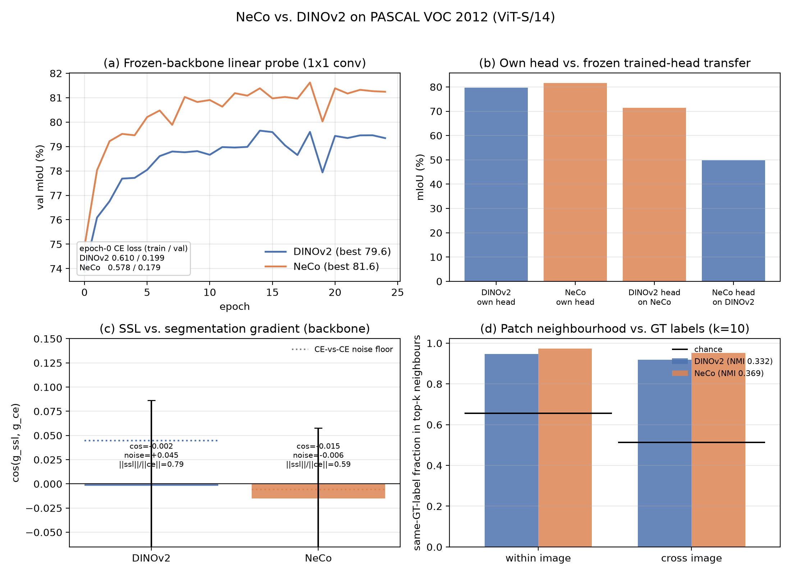

*NeCo vs. DINOv2 under an identical protocol. (a) frozen-backbone linear probe;
(b) each backbone with its own trained head, and with the other backbone's
frozen head; (c) cosine between the SSL gradient and the segmentation gradient
on the backbone, with the CE-vs-CE noise floor measured by perturbing the data
order; (d) fraction of top-10 patch neighbours sharing the query's GT label.*

| metric | DINOv2 | NeCo |
|---|---|---|
| linear probe mIoU (best) | 79.65 | **81.62** |
| linear probe mIoU (final, ep 25) | 79.34 | **81.24** |
| epoch-0 train CE | 0.6103 | **0.5785** |
| epoch-0 val CE | 0.1993 | **0.1793** |
| gradient cosine (SSL vs. CE) | −0.002 | −0.015 |
| gradient norm ratio ‖g_ssl‖/‖g_ce‖ | 0.79 | 0.59 |
| kNN same label, within image | 0.947 | **0.973** |
| kNN same label, cross image | 0.918 | **0.952** |
| kNN vote accuracy, cross image | 0.946 | **0.973** |
| k-means NMI | 0.332 | **0.369** |
| k-means ARI | 0.044 | 0.049 |

### 7.1 Setup

- **Code and weights**: official `vpariza/NeCo` repository, released
  `neco_on_dinov2_vit14_{model,teacher}.ckpt` (ViT-S/14, DINOv2-initialised,
  21M parameters), plus the plain `dinov2_vits14` weights as the control.
- **Data**: VOC 2012 `trainaug` (10 582 images), val (1 449). Images resized to
  448×448, patch 14 → 32×32 tokens.
- **Probe protocol** (as in the paper): backbone frozen; one 1×1 convolution on
  the patch tokens, bilinearly resized to 100×100; SGD, lr 0.01, momentum 0.9,
  weight decay 1e-4, batch 128, 25 epochs, step decay ×0.1 at epoch 20; CE with
  class 255 ignored; mIoU on the 21 VOC classes.
- **Seed matching**: both runs use seed 400, so the head initialisation *and* the
  data order are identical. Any epoch-0 loss difference therefore comes from the
  features alone, exactly as in the ActionFormer stage-B comparison (§3.4).
- **Protocol check**: our NeCo run lands at 81.62 against the paper's 81.4 for
  this backbone — within 0.3 pp, so the pipeline reproduces the published
  number. The DINOv2 control (79.65) is the relevant baseline, not a
  paper-quoted absolute.

### 7.2 Option 2: linear probe — does the SSL init start lower?

Modestly, and then the gap widens. NeCo reaches **81.62** best mIoU against
**79.65** for DINOv2 (+1.97 pp; +1.90 pp on the final epoch), and it is ahead
from the first epoch on (panel a) — this is not a lucky late-epoch spike.

The epoch-0 loss is the sharper test, because there the head is the same random
1×1 convolution in both runs and the optimizer takes the same number of steps:

- train CE **0.5785 vs 0.6103** (−5%), val CE **0.1793 vs 0.1993** (−10%);
  epoch-0 mIoU 74.91 vs 73.87.

So the sign is the same as the eventual result — NeCo does start lower — but the
head start is small compared with the 2 pp it ends up with. That is worth
stating plainly, because it is a direct caution about the loss-start probe used
in §3.4: a 5–10% lower first-epoch CE here coexists with a 2 pp mIoU gain, while
in the ActionFormer runs a 0.1–0.6% *higher* first-epoch loss coexisted with a
flat mAP. The probe is directionally informative at best; the trajectory and the
final mIoU carry the result.

> **Batch-size caveat (why the numbers changed).** A first NeCo probe was run at
> batch 64 instead of the paper's 128, i.e. 165 optimizer steps per epoch instead
> of 82. Its epoch-0 loss was 0.3965/0.1514 — a 35% lower train CE that looked
> like a dramatic head start but was mostly twice the optimization. The table
> and figure use the rerun at batch 128, matched to DINOv2. This is also why the
> epoch-0 numbers must be read only within a matched protocol.

That the epoch-0 gap is *not* a feature-scale artifact can be checked directly:
mean patch-token L2 norm is 49.6 (DINOv2) vs 52.9 (NeCo), a 7% difference, far
too small to explain even the 5–10% CE gap. NeCo's tokens are also more uniformly
scaled across patches (std 1.70 vs 2.75), which is itself the kind of property a
linear head exploits.

**Cross-head transfer** (panel b) asks whether the two representations are
merely differently *scaled* or actually different. Freezing each trained head and
evaluating it on the other backbone:

| trained head | evaluated on | mIoU | val CE |
|---|---|---|---|
| DINOv2 | DINOv2 | 79.65 | 0.1422 |
| DINOv2 | NeCo | 71.39 | 0.2251 |
| NeCo | NeCo | 81.62 | 0.1213 |
| NeCo | DINOv2 | 49.86 | 0.8921 |

Neither head transfers, and the asymmetry is informative: the DINOv2 head keeps
71.4 on NeCo features, whereas the NeCo head collapses to 49.9 on DINOv2. A head
trained on the sharper representation is tuned to a feature geometry the original
DINOv2 backbone does not have, so NeCo is not a mild rescaling of DINOv2 — it
moves the features somewhere else, and that somewhere else is better for dense
prediction.

### 7.3 Option 4: gradient alignment — a null result

A different question is whether the *SSL gradient* points in the same direction
as the *downstream* gradient on the backbone. For 20 random batches we compute
g_ssl = ∇_backbone L_NeCo (the actual `shared_step` loss, teacher forward,
student backward, model in `eval()` to remove drop-path noise) and
g_ce = ∇_backbone L_CE (through the trained probe head, masks downsampled to the
100×100 prediction grid), then report the cosine over the full backbone
parameter vector. The noise floor is the cosine between two CE gradients on
different batches.

| backbone | cos(g_ssl, g_ce) | CE-vs-CE noise floor | ‖g_ssl‖/‖g_ce‖ |
|---|---|---|---|
| DINOv2 | −0.002 ± 0.088 | +0.045 ± 0.104 | 0.79 |
| NeCo | −0.015 ± 0.073 | −0.006 ± 0.127 | 0.59 |

Both cosines are **zero to within the noise floor**: at the level of individual
backbone parameters, the SSL gradient carries no directional information about
the segmentation gradient for either model, and no parameter group stands out
(|cos| ≤ 0.05 for every block, `cls_token`, `pos_embed`, `norm`).

Two things follow. First, this is *not* the mechanism behind NeCo's +2 pp: the
gain comes from the representation the objective produces (options 2 and 5), not
from a gradient that conveniently points at the downstream loss. Second, the
norm ratio is the more interesting number: NeCo's SSL gradient is only **three
fifths** the size of the CE gradient (0.59 vs 0.79) on the same backbone and data.
The NeCo objective asks for less backbone movement per unit of downstream signal,
which is the same "the head absorbs the objective" behaviour measured directly in
the ActionFormer encoder (§6.2).

### 7.4 Option 5: does the neighbourhood structure agree with GT labels?

Options 2–4 all involve a trained head (as the probe itself, or as the source of
the downstream gradient). Option 5 removes the head entirely and asks
whether NeCo's similarity structure is *semantically* right: for every patch in
400 val images (32×32 grid, 404 167 valid patches), take its 10 nearest
neighbours by cosine — within the same image and across the whole set — and check
whether they carry the query patch's GT label.

| | DINOv2 | NeCo | chance |
|---|---|---|---|
| same-label fraction, within image | 0.947 | **0.973** | 0.656 |
| same-label fraction, cross image | 0.918 | **0.952** | 0.513 |
| majority-vote accuracy, cross image | 0.946 | **0.973** | 0.513 |
| lift over chance, within | 0.846 | **0.922** | — |
| lift over chance, cross | 0.832 | **0.901** | — |
| k-means NMI / ARI | 0.332 / 0.044 | **0.369** / 0.049 | — |

The absolute numbers are high for both models because VOC patches are dominated
by a few large classes and neighbouring patches are spatially correlated; that is
why chance (the label prior over the same patch population) is reported alongside,
and why the useful quantity is the *lift*. NeCo improves the lift over chance by
+0.08 within image and +0.07 across images, and it does so at a *fixed* k, so the
comparison is not bought by a different neighbourhood size. The same pattern
appears without any labels at all: k-means on NeCo features aligns better with
the 21 VOC classes (NMI 0.332 → 0.369).

This is the most direct evidence against the "too far from the downstream
objective" hypothesis in this setting. NeCo's objective is neighbour-order
consistency; the quantity it improves is precisely neighbour-label consistency.
The objective and the downstream task share their notion of "what should be
close to what".

### 7.5 What this means for the ActionFormer result

1. **The objective is not generically misaligned.** In the setting NeCo was
   designed for, it gives +2 pp linear-probe mIoU, a 5–10% lower epoch-0 CE loss
   in both train and val, a +0.07–0.08 lift in patch-neighbour label agreement,
   and a +0.04 NMI — all in the same direction, from three methodologically
   independent measurements. The "far from downstream" explanation cannot be a
   property of the objective as such.
2. **Gradient alignment is not the mechanism anywhere.** It is null for DINOv2
   *and* for NeCo (§7.3), so it neither explains NeCo's success here nor its
   failure on ActionFormer. What separates the two settings is the
   representation, not the gradient direction.
3. **What is different in the ActionFormer setting is the object being
   trained.** NeCo's neighbours are *spatial patches of an image*: adjacency is a
   meaningful prior, and the downstream task (per-pixel labelling) is exactly a
   patch-level decision. In ActionFormer the SSL views are *time crops of a
   feature sequence*, the "patches" are already-supervised 1024-d EPIC features,
   and the downstream task is sparse — one verb label and two boundaries per
   window over 100+ classes. There is no patch-adjacency prior to exploit, and
   the encoder's job is temporal aggregation, not per-element labelling.
4. **Consistent with §6 rather than contradicting it.** Section 6 concluded that
   what matters is the representation, and that the ActionFormer encoder cannot
   reach the representation because the features are frozen upstream. Section 7
   shows that when NeCo *can* change the representation, it improves dense
   prediction. The two results are the same claim seen from both sides.
5. **Scope of the null result.** The ActionFormer finding should therefore be
   read as "NeCo on a frozen, already-supervised feature encoder for sparse
   temporal labelling does not help" — a statement about that pipeline — not as
   evidence that the NeCo objective is weak.

**Caveats.** One seed per run on VOC (the probe curve is stable across epochs,
but the ±2 pp is not a seed-replicated estimate); 400 images for option 5;
option 4 averages 20 batches, so it can only detect alignment larger than ~0.05,
which is enough to rule out the "the SSL gradient points at the task" story but
not to resolve a small positive alignment. Batch size matters for the epoch-0
numbers (see the caveat in §7.2), so only the matched-protocol pair is quoted.

## 8. Reproducibility Notes

- All results: EPIC-100 **verb** task, validation split.
- **Supervised baselines**: `train_verb_4621944.out` (V-JEPA2, 17.49) and
  `logs/eval_1657178.out` (SlowFast, 23.07); checkpoint
  `ckpt/epic_slowfast_verb_reproduce/epoch_021.pth.tar`.
- **Pipeline 2 SSL runs**: `ssl_neco_slowfast_warm_4988444.out`,
  `ssl_neco_vjepa2_4917434.out`. Downstream eval: `eval_ssl.py
  configs/epic_slowfast_verb.yaml ckpt_ssl/ssl_epic_slowfast_verb_neco_warm/epoch_012.pth.tar
  --head-from ckpt/epic_slowfast_verb_reproduce/epoch_021.pth.tar` (job 4991145,
  48 min; 207 encoder + 22 head keys, EMA on both sides).
- **Pipeline 3, SlowFast**: stage A job 4796515 → `ckpt_ssl/ssl_epic_slowfast_verb_neco/`;
  stage B `train_verb_from_ssl.slurm` (job 5077230, 1h06m; 207 encoder keys matched,
  22 head keys random, 0 unexpected) → `ckpt/epic_slowfast_verb_from_ssl_neco/epoch_021.pth.tar`.
- **Joint fine-tune ablation**: `train_verb_ft_joint_ssl_warm.slurm` (job 5093320) and
  control `train_verb_ft_joint_ctrl.slurm` (job 5093321), 21 min each;
  `ckpt/epic_slowfast_verb_joint_ft_{ssl_warm,ctrl}/`.
- **Pipeline 3, V-JEPA2**: stage A `train_ssl_vjepa2_cold.slurm` (job 5093340, 7m45s)
  → `ckpt_ssl/ssl_epic_vjepa2_verb_neco_vjepa2_cold/`; stage B
  `train_verb_vjepa2_from_ssl.slurm` (job 5093405, 1h04; 207 encoder keys matched,
  22 missing, 0 unexpected) → `ckpt/epic_vjepa2_verb_from_ssl_neco/epoch_021.pth.tar`.
  A first attempt (job 5093341) was cancelled at epoch 15 by mistake and rerun from
  scratch; its partial output is in `ckpt/_cancelled/`.
- **VideoMAE-L baseline**: features in
  `data/epic_kitchens/features_videomae_verb/` (OpenTAD release, 700 videos);
  `train_verb_videomae.slurm` (job 5093406, 1h16) →
  `ckpt/epic_videomae_verb_reproduce/epoch_021.pth.tar`. A first attempt (job
  5093366) was likewise cancelled at epoch 5 and rerun.
- **Seed replicates** (`--seed 1`, `--seed 2`): baselines `train_verb_seed.slurm`
  (jobs 5094858, 5094861) → `ckpt/epic_slowfast_verb_reproduce_seed{1,2}/`;
  pipeline 3 stage A `train_ssl_seed.slurm` (5094859, 5094862) →
  `ckpt_ssl/ssl_epic_slowfast_verb_neco_seed{1,2}/`, stage B
  `train_verb_from_ssl_seed.slurm` (5094860, 5094863) →
  `ckpt/epic_slowfast_verb_from_ssl_neco_seed{1,2}/`. Submit with
  `sbatch --export=ALL,SEED=<n> <script>`.
- **Frame-rate augmentation**: stage A `train_ssl_rate.slurm` (job 5094852) →
  `ckpt_ssl/ssl_epic_slowfast_verb_rate_neco/`; stage B `train_verb_from_ssl_rate.slurm`
  (5094853, 1h06) → `ckpt/epic_slowfast_verb_from_ssl_neco_rate/epoch_021.pth.tar`.
- **VideoMAE-L SSL**: pipeline 3 `train_ssl_videomae_cold.slurm` (5094854) →
  `train_verb_videomae_from_ssl.slurm` (5094855, 1h16) →
  `ckpt/epic_videomae_verb_from_ssl_neco/`; pipeline 2 `train_ssl_videomae_warm.slurm`
  (5094856) → `eval_ssl_videomae_warm.slurm` (5094857; 207 encoder + 22 head keys).
- All encoder inits verified at load: 207 encoder keys matched, 0 unexpected.
- **Figures**: `figs/ssl_pretrain_loss.{png,jpg}`,
  `figs/supervised_loss_comparison.{png,jpg}`, produced by `tools/plot_loss_curves.py`.

**NeCo / VOC experiment (§7).** Runs on the ALICE cluster in a separate tree
(`/zfsstore/user/s4561341/neco_diag`), conda env `neco_diag` (torch 2.5.1+cu124,
timm, pytorch-lightning, diffsort, faiss), with the official repository checked
out at `/zfsstore/user/s4561341/neco_repo`.

- **Data**: VOC 2012 + `SegmentationClassAug`; splits `sets/trainaug.txt`
  (10 582) and `sets/val.txt` (1 449).
- **Checkpoints**: `ckpt/dinov2_vits14_pretrain.pth`,
  `ckpt/neco_dinov2_vits14_student.ckpt`, `ckpt/neco_dinov2_vits14_teacher.ckpt`
  (the released NeCo checkpoints are plain dicts: backbone + `projection_head.*`).
- **Option 2** — `neco_diag/linear_probe.py`, seed 400, 25 epochs, batch 128
  (both backbones; a first NeCo run at batch 64 is discarded, §7.2),
  `--out results/probe_{dinov2,neco}_voc.json`; trained heads saved as
  `results/probe_*_voc_head.pt`; cross-head transfer via `--eval-only --head ...`
  → `results/xfer_{trainer}head_{eval}.json`.
- **Option 4** — `neco_diag/grad_alignment.py`, 20 iterations of batch 8, models
  in `eval()`, teacher forward for the NeCo loss, `on_train_epoch_start()` called
  to build the `DiffSortNet` → `results/grad_align_{dinov2,neco}.json`.
- **Option 5** — `neco_diag/neighbor_label_agreement.py`, 400 val images, 32×32
  patch grid, k = 10, k-means with 21 clusters →
  `results/neighbor_agreement_{dinov2,neco}.json`.
- **Figure and table** — `neco_diag/make_figs.py` builds
  `neco_diag/figs/neco_diagnostics.png` and prints the summary table from those
  JSONs. Batch scripts for the same jobs are in `neco_diag/scripts/*.slurm`.
- Protocol notes: masks are nearest-downsampled to the 100×100 prediction grid
  before the CE (the paper compares at 100×100); mIoU is computed from a
  confusion matrix and averaged over the classes present in the val set (all 21
  VOC classes occur, so this is the usual 21-class mIoU, with no Hungarian
  matching — the head is supervised).
