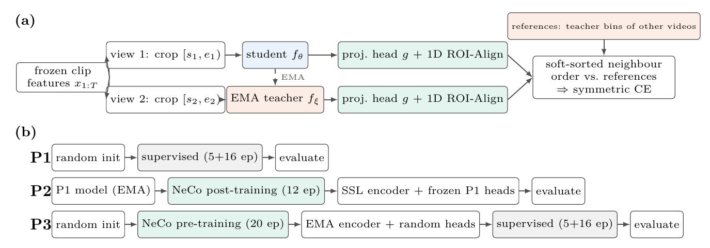
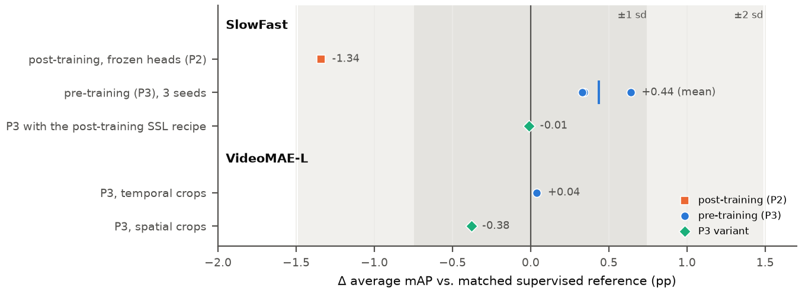
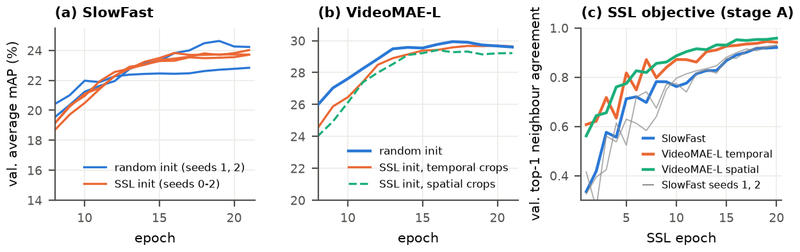
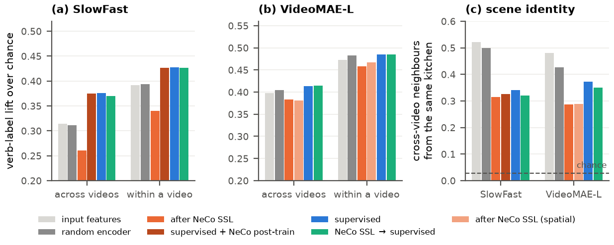

# Self-Supervised Pre/Post-Training for Temporal Action Localization with ActionFormer

*Last updated: 2026-11-25. Write-up of the NeCo-style SSL experiments on ActionFormer
(EPIC-KITCHENS-100 verbs), matching the thesis paper `paper/main.pdf`.*

> **Note.** All results here come from the corrected SSL pipeline (2026-11-22):
> NeCo references from the teacher, EMA teacher momentum 0.99 → 1, and SSL warm starts
> from the supervised EMA weights. Results obtained before that date are invalid and
> have been removed from this report. The earlier, longer version (pre-fix experiments,
> joint fine-tune ablation, frame-rate augmentation, CKA analysis, and the detailed
> NeCo-on-VOC protocol notes) is in git history at commit `89b5c89`
> (`git show 89b5c89:report.md`).

## Results, figures and how to read them

This section reproduces every figure of the thesis paper (`paper/main.pdf`) with the
corrected pipeline's results, defines each metric, and explains how to read each
figure. Figures are PNG copies of the paper's vector figures (`paper/figs/png/`,
regenerated by `paper/scripts/make_figures.py`).

### 1. Metrics used

| Metric | What it measures | How to read it |
|---|---|---|
| **mAP @ tIoU** | Detection quality. A predicted segment counts as correct if it has the right verb and its temporal IoU (overlap / union of start–end intervals) with a ground-truth segment is above the threshold; AP is computed per verb class and averaged. Reported at tIoU 0.1–0.5 and as their mean (**avg mAP**). | Higher is better. Low tIoU (0.1) rewards finding the action at all; high tIoU (0.5) rewards accurate boundaries. |
| **Seed s.d. / Welch t** | Run-to-run spread of the same recipe with different random seeds (SlowFast baseline: 0.75 pp), and a t-test for the difference of two means with unequal variances. | A difference smaller than ~1–2 s.d. is within noise. Welch *t* ≈ 1 with 3 runs per arm (≈2 degrees of freedom) means *p* ≈ 0.4: not significant. |
| **Relative weight change** | ‖W − W₀‖ / ‖W₀‖ over all backbone weights, W₀ = the starting point. | How much a training stage changed the encoder. 0% = untouched; supervised training changes it ~23%. Says nothing about whether the change is useful. |
| **NeCo loss / top-1 neighbour agreement** | The SSL objective itself. Agreement = fraction of anchors whose nearest reference is the same in both views. | How well SSL fits its own objective (1.0 = perfect). High agreement does **not** imply a better downstream detector. |
| **Verb-label lift** (neighbour-label probe) | For each foreground validation timestep (one encoder vector ≈ 1 s of video), take its 10 nearest neighbours by cosine similarity, look up their **ground-truth** verb labels, and count how often one matches the query's verb (*a*). Compare with the same fraction over all candidates (chance, *c*): lift = (*a* − *c*) / (1 − *c*). No classifier is involved. | 0 = neighbours share the verb no more often than random timesteps; 1 = all of them do. It is a chance-corrected agreement (same form as Cohen's kappa), not the ratio called "lift" in data mining. **Across videos** = neighbours from other videos (semantic grouping); **within a video** = neighbours from the same video, ±16 steps excluded (separating different actions in the same scene, which TAL needs). |
| **Kitchen probe** | Same neighbour search across videos, but counting how often the neighbours come from the **same kitchen** (participant) as the query. Chance = 0.03 (32 kitchens). | High = the representation groups moments by scene. Tests whether SSL learns a scene shortcut. |
| **Δ first-epoch loss (head-start probe)** | Supervised loss in the first epoch of an SSL-initialised run minus that of a randomly initialised run with the same head initialisation and data order, in %. | Negative = the SSL encoder is a better starting point; positive = worse. |
| **View identity** | Fraction of the ROI bins (positions compared between the two SSL views) whose whole receptive field lies inside both crops, i.e. where both views give the encoder identical input. | High = the two views are mostly the same input, so "be consistent across views" asks for little. |
| **mIoU** (VOC control) | Mean intersection-over-union of predicted vs. true segmentation masks over the 21 PASCAL VOC classes. | Higher is better; the standard semantic-segmentation metric. |

Labels for the neighbour probe come from the annotations: a timestep is labelled by
the centre of its clip window and gets *all* verbs whose annotated segment contains that
centre (a match = the label sets share a verb); timesteps outside every segment are
background and never count as a match.

### 2. Protocols (Fig. 1)

**What it shows.** (a) NeCo adapted to a 1D sequence: two overlapping crops of the
same pre-extracted clip-feature sequence go through a student and an EMA teacher;
every pyramid level is projected and ROI-aligned onto the crops' overlap; the loss asks
that each position rank the reference positions (teacher features of the *other*
videos in the batch) in the same order in both views. (b) The three protocols:

- **P1** — supervised baseline (standard ActionFormer recipe).
- **P2 (post-training)** — start from the trained P1 model, train the encoder with NeCo
  (NeCo's own post-training recipe: small encoder learning rate), then put the encoder
  back under the **frozen** P1 heads and evaluate.
- **P3 (pre-training)** — NeCo from a random initialisation (stage A, from-scratch recipe:
  encoder lr 1e-4, 20 epochs), then load the SSL encoder and run the unmodified P1
  recipe (stage B). Only the encoder's starting point differs from P1.

### 3. Main results (Table 2 and Fig. 2)

| Features | Model | 0.1 | 0.2 | 0.3 | 0.4 | 0.5 | Avg |
|---|---|---|---|---|---|---|---|
| SlowFast | ActionFormer paper | 26.6 | 25.4 | 24.2 | 22.3 | 19.1 | 23.5 |
| SlowFast | P1 baseline (n=3) | 26.67 | 25.51 | 24.16 | 21.98 | 18.58 | 23.38 ± 0.75 |
| SlowFast | P1, seed 0 (start of P2) | 26.40 | 25.15 | 23.73 | 21.70 | 18.35 | 23.07 |
| SlowFast | P2 post-training, frozen heads | 25.05 | 24.05 | 22.49 | 20.07 | 17.01 | **21.73** |
| SlowFast | P3 pre-training (n=3) | 26.89 | 25.96 | 24.38 | 22.59 | 19.27 | **23.82 ± 0.18** |
| SlowFast | P3 with the post-training SSL recipe | 26.78 | 25.39 | 23.92 | 22.07 | 18.67 | 23.37 |
| VideoMAE-L | P1 baseline | 32.84 | 32.06 | 30.42 | 28.11 | 24.59 | 29.60 |
| VideoMAE-L | P3, temporal crops | 32.90 | 32.25 | 30.38 | 28.12 | 24.54 | **29.64** |
| VideoMAE-L | P3, spatial crops | 32.48 | 31.78 | 30.20 | 27.85 | 23.77 | **29.22** |
| V-JEPA 2 | P1 baseline | 20.51 | 19.74 | 18.38 | 16.17 | 12.64 | 17.49 |

**How to read Fig. 2.** Each marker is one run's avg mAP minus its matched supervised
reference (P2 vs. the model it started from, P3 vs. the baseline of the same
features). The vertical line at 0 means "no change". The grey bands are ±1 and ±2
standard deviations of the SlowFast baseline over seeds — the size of differences that
appear just from re-running with another seed.

**Takeaway.** Post-training lands well outside the noise band (−1.34 pp). Every
pre-training variant sits inside ±1 s.d.: the SlowFast mean of +0.44 is not
significant (Welch *t* ≈ 1.0, *p* ≈ 0.4), and VideoMAE-L is +0.04 (temporal) /
−0.38 (spatial). Pre-training with NeCo's gentle post-training recipe barely moves the
encoder and gives exactly the baseline (−0.01). Feature choice matters far more:
VideoMAE-L is +6.2 pp over SlowFast.

### 4. Training curves (Fig. 3)

**How to read.** (a, b) Validation avg mAP after each epoch of supervised training,
blue = random encoder init, orange/green = SSL-initialised; early epochs (<8) are cut
off because all runs start near 0. (c) The SSL objective during stage A: top-1
neighbour agreement on validation videos after each SSL epoch.

**Takeaway.** In (a) the SSL-initialised runs sit inside the band spanned by the
baseline seeds the whole time — the gap between seeds is as large as any gap between
arms. In (b) the SSL runs track the baseline and end at or slightly below it. In (c)
every SSL run fits its objective well (agreement 0.92–0.96), so the null result is not
an SSL stage that failed to optimise.

### 5. Does SSL train the encoder, and does it give a head start? (Fig. 4)

**How to read (a).** Relative weight change of the backbone from the point each stage
started at, on a log scale. Grey: supervised training from a random init (P1, 22.6%) and
from the SSL weights (P3 stage B, 23.6%, mean of three seeds). Blue: the SSL stage
(P3 stage A). Orange: P2 post-training, measured from the supervised weights. Green:
a from-scratch SSL stage run with NeCo's post-training learning rates.

**How to read (b).** First-epoch supervised loss of the SSL-initialised run minus that
of the randomly initialised run, in %, for seed-matched pairs (same head init and data
order). Bars above 0 = SSL start is worse. The orange bars are the same probe in NeCo's
own setting (VOC), for comparison.

**Takeaway.** The SSL stage does change the encoder (4.4–4.8%, a fifth of supervised
training), so the null result is not an untrained encoder. But that change is a slightly
*worse* starting point for TAL (+1.4 to +4.7% first-epoch loss), whereas on VOC NeCo's
change is a better one (−5 to −10%). Supervised training then moves the encoder 23–24%
from the SSL weights — as far as from a random init and ~5× further than SSL did.

### 6. Neighbour structure and scene identity (Fig. 5) — the central result

**How to read (a, b).** Verb-label lift (§1) of the encoder's per-timestep features,
for neighbours from other videos (left group) and from the same video (right group).
Each bar is one encoder: light grey = the raw input clip features, dark grey = the
ActionFormer encoder at its random init, orange = after NeCo SSL (pale orange: spatial
crops), dark orange = the supervised encoder after NeCo post-training (P2), blue =
supervised (P1), green = SSL-initialised then supervised (P3). Higher = same-verb
moments are closer together in feature space.

**How to read (c).** Fraction of a timestep's cross-video neighbours that come from the
same kitchen; dashed line = chance (0.03).

**Takeaway.**
- NeCo SSL from scratch **lowers** verb-label lift below even the untrained encoder
  (SlowFast 0.31 → 0.26 across videos, 0.39 → 0.34 within; VideoMAE-L 0.41 → 0.38 /
  0.48 → 0.46). On VOC the same kind of probe goes *up* with NeCo. In this setting the
  objective pulls same-verb moments apart.
- Supervised training raises the lift (blue), and the SSL-initialised encoder ends
  exactly where the randomly initialised one does (green ≈ blue): no measurable trace
  of the SSL stage remains.
- NeCo post-training (dark orange) leaves the verb grouping of the supervised encoder
  intact (0.375 vs. 0.375). So P2's −1.34 pp is not lost verb structure but the features
  shifting away from what the frozen heads were fitted to.
- Spatial crops (pale orange) give the same drop as temporal crops, so the cause is not
  how the views are made.
- (c) NeCo does **not** learn a scene shortcut: it *reduces* same-kitchen neighbours
  (SlowFast 0.50 → 0.31, below even supervised 0.34). It removes scene and verb
  structure together.

### 7. How similar are the two SSL views? (Fig. 6)

**How to read (a).** Receptive field (the span of input the encoder sees for one output
position) of each pyramid level, in seconds, against the median length of the overlap
region of the two SSL crops (dashed). (b) Fraction of overlap positions at each level
for which both crops give the encoder identical input, computed by running the actual
crop sampler on the real training-video lengths.

**Takeaway.** With temporal crops of pre-extracted features, 93% (SlowFast) / 97%
(VideoMAE-L) of the finest-level positions receive identical input in both views; only
the coarsest levels, whose receptive fields exceed the overlap, see different context.
Image NeCo's views differ at every pixel (colour, blur, scale). This made view identity
a natural suspect, but Fig. 5 shows spatial crops (which differ everywhere) behave the
same, so it is not the main cause.

### 8. Control: NeCo in its own setting (Fig. 7, Table 3)

**How to read.** NeCo-post-trained DINOv2 (orange) vs. the original DINOv2 (blue) on
PASCAL VOC segmentation, identical seed-matched protocol. (a) mIoU of a frozen-backbone
linear probe per training epoch. (b) Cross-head transfer: a head trained on one backbone
evaluated on the other (x-axis = backbone evaluated, in brackets = whose head); a large
drop means the two representations genuinely differ rather than being rescaled
copies. (c) Patch-neighbour label lift — the same metric as Fig. 5, on image patches.

| Probe (NeCo vs. its start) | VOC (DINOv2) | EPIC: SlowFast / VideoMAE-L |
|---|---|---|
| neighbour-label lift, across images/videos | 0.83 → 0.90 | 0.31 → 0.26 / 0.41 → 0.38 |
| neighbour-label lift, within image/video | 0.85 → 0.92 | 0.39 → 0.34 / 0.48 → 0.46 |
| first-epoch downstream loss | −5% (train), −10% (val) | +4.0%, +4.7% / +1.4% |
| downstream metric | +2.0 mIoU | +0.44 pp (n.s.) / +0.04 pp |

**Takeaway.** In NeCo's own setting every probe points the right way: neighbours become
more label-consistent, the downstream task starts with a lower loss, and mIoU rises
by 2.0. On EPIC every probe points the other way. The objective is the same; what
differs is the setting. Views and scene shortcuts are ruled out above, which leaves the
starting representation: on VOC NeCo sharpens generic features whose neighbourhoods
already follow object classes; on EPIC it re-mixes clip features already supervised for
the target verbs, and its target (a consistent ordering relative to other videos) does
not coincide with verb identity.

### 9. Summary

NeCo-style SSL does not help ActionFormer on EPIC-KITCHENS-100 verbs. Post-training
costs 1.34 pp (head mismatch); pre-training is within seed noise on SlowFast (3 seeds)
and VideoMAE-L. The SSL stage works as an SSL stage (fits its objective, moves the
encoder 4–5%), but in this setting it moves timestep neighbourhoods away from verbs,
gives a slightly worse starting point, and supervised training erases it. Single-run
caveats: VideoMAE-L P3 and P2 are one seed each.
